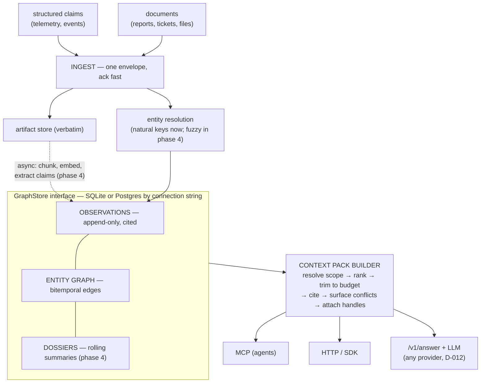
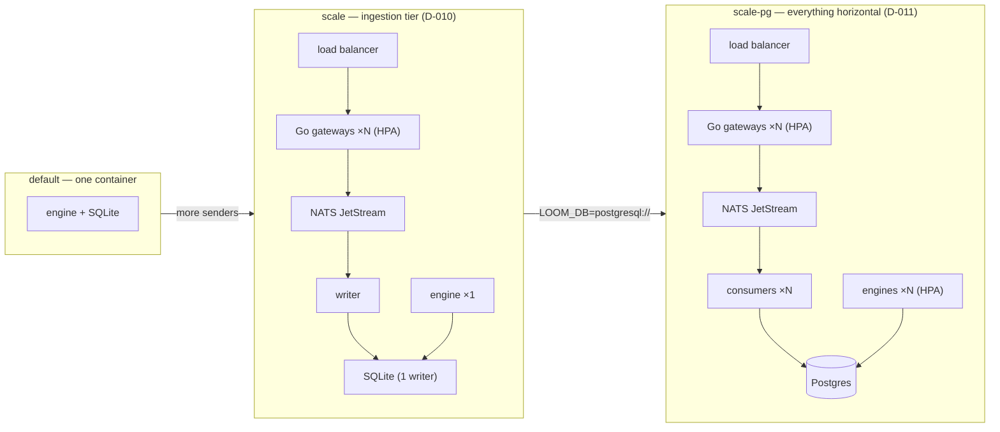

# Architecture

Loom is a **context engine**: it absorbs data about entities over time and serves
agents small, question-scoped slices of that knowledge. It is neutral about the
data and about intent — the same store serves blue-team questions (what happened,
what's exposed) and red-team questions (what's exploitable, what can I reach); the
read path just shapes whatever's in the graph to the question asked. The
load-bearing decision is the split between a **write path** and a **read path** with
opposite temperaments.

- **Write path — greedy and thorough.** Accept every incoming piece of data, resolve
  it to an entity, store it append-only with full provenance and timestamps, and do
  all expensive enrichment (summarization, embedding, extraction, linking)
  **asynchronously** in background workers.
- **Read path — cheap and stingy.** When an agent asks about an entity, assemble a
  **context pack**: a token-budgeted, ranked, cited answer with opaque handles for
  drilling deeper. Never the whole record.

The graph is the *index*, not the payload. Agents never traverse it directly; they
talk to a retrieval contract that performs scoped traversal for them.

## Data model — three layers, raw to refined

### 1. Observations (append-only ground truth)

Immutable records of "source S asserted fact F about entity E at time T":

```
(id, namespace, subject, predicate, object, observed_at, valid_from?, valid_to?,
 recorded_at, source, confidence, provenance?, attrs)
```

Never edited, only superseded. This is the audit trail everything else derives from,
and the layer that makes every claim in a context pack citable.

### 2. Entities & relations (the bitemporal graph)

Canonical nodes produced by entity resolution, connected by edges that carry **two
time axes**:

- `valid_from` / `valid_to` — when the fact was true in the world
- `recorded_at` — when Loom learned it

This makes "what did we know about X as of June?" and "what was true of X in June?"
distinct, answerable questions.

**Identity-over-time rule:** identifiers that get reassigned (IP addresses, hostnames,
seat assignments, badge numbers) are modeled as **time-bounded edges**, not entity
properties. `10.0.4.7` is not a property of `web-01`; it is
`(ip:10.0.4.7) -ASSIGNED_TO{valid_from, valid_to}-> (host:web-01)`. This is what makes
"which host had this IP during the incident window?" a first-class query.

### 3. Dossiers (precomputed read-side material)

Rolling, hierarchical summaries per entity, rebuilt asynchronously when enough new
observations accumulate:

- a one-paragraph **brief**
- per-**facet** summaries (e.g. `identity`, `activity`, `relationships`, `security`)
- every sentence linked back to the observations that support it

Dossiers exist so that read-time is mostly a lookup and a trim, not an LLM call.

## Ingestion — two front doors, one observation model

A single envelope with a `kind` discriminator:

**`claim`** — structured, entity-addressed events (telemetry, logs, pipeline
outputs). Map ~1:1 onto observations. No LLM involved: cheap, synchronous,
high-volume friendly.

**`document`** — unstructured content (reports, tickets, emails, files forwarded by
pipeline devices). Path:

1. Store the raw bytes as an immutable **artifact** (nothing is ever lost).
2. Acknowledge immediately — extraction never blocks the write path.
3. Async: chunk + embed for semantic search.
4. Async: **claim extraction** — an LLM pass pulls entity mentions and factual claims,
   which become ordinary observations, each linked to the exact document span it came
   from (lower default confidence, provenance pointer into the artifact).

After extraction, a claim mined from a PDF and a claim from a syslog event are the
same shape in the store; only metadata differs.

## Entity resolution — two tiers

- **Deterministic:** structured claims resolve by natural keys per the schema
  registry (`host:web-01`, `user:jdoe`). Fast, no ambiguity.
- **Fuzzy:** document mentions resolve via alias tables → embedding similarity →
  LLM adjudication for the ambiguous remainder. An unresolvable mention becomes a
  **provisional entity** (never dropped) that can be merged later. Merges are
  recorded as events themselves, so they are auditable and reversible.

## The retrieval contract (the differentiator)

Every read request carries:

- a **subject** (entity handle or search string)
- a **question or facet** (what about it?)
- a **token budget** (the caller decides what it can afford)
- optionally an **as-of** time

The engine answers with a **context pack**:

- the relevant dossier slice, ranked and trimmed to fit the budget
- relevant edges from a *pruned* k-hop traversal (relevance-scored, never "everything
  within 2 hops")
- **citations** — which observations back each item
- **expansion handles** — opaque IDs the agent passes back to say "more about *this*
  thread" (a document chunk, a neighbor entity, a time window)
- **surfaced conflicts** — contradictions between sources are shown explicitly
  ("source A says X as of March; source B says Y as of May"), never silently merged

Ranking inside the budget combines: semantic similarity to the question, graph
distance from the subject, recency/decay, and source confidence.

**Progressive disclosure is the point:** the agent starts with ~500 tokens and pulls
more only when the question demands it. That is what keeps agent context clean.

**Scopes** extend the contract beyond a single entity: a question may name
several subjects at once, or an anchor plus everything reachable over
containment predicates ("domain corp.local and its contents" =
`{subjects: [domain], expand: [member_of], depth: 1}`). The engine resolves
the scope by bounded BFS, gathers across all resolved entities, dedupes,
runs conflict detection per subject, and fits everything into one shared
budget. With no subject at all, `/v1/answer` resolves entities whose keys
appear verbatim in the question.

**Answering (`/v1/answer`)** closes the loop for teams that want a decision,
not just context: the engine builds the pack, then a configured LLM — any
OpenAI-compatible provider (OpenRouter, Venice, Groq, ...), a self-hosted
endpoint (Ollama/vLLM), or Anthropic — synthesizes a cited answer under a
grounding prompt. The pack rides along in the response for audit (D-012).

## Access surfaces — shells over one core

1. **MCP server** (primary, for agents): `find_entity`, `find_related`, `ask`,
   `ask_scope`, `expand`, `record_claim`, `get_observations`, `answer`. Agents
   also *write back* what they learn.
2. **HTTP API + thin SDKs** (Python, TypeScript, Go; OpenAPI for the rest) for
   apps and custom pipeline code. `POST /v1/ingest/batch` takes a JSON array or
   NDJSON, which is what log shippers' HTTP outputs produce.
3. **Pipeline adapters** for what teams already run: Fluent Bit / Vector
   configs that reshape records into envelopes, a Kafka/Redpanda consumer that
   reads envelopes from existing topics, and a bulk loader for NDJSON files
   from any language (D-034).
4. **Operator modules** (`loom.keys`, `loom.lifecycle`, `loom.seed`,
   `loom.ingest`, `loom.loadgen`) for humans.

All of them are shells over one internal service, so behavior never diverges.

## Multi-tenancy

Everything is scoped by **namespace** (present in every contract from day one).
Different teams either share a deployment with isolated namespaces or run their own
compose stack — both work because the deployment is one small container plus a volume.

## Ingestion tier — two shapes, one contract (D-010)

`POST /v1/ingest` (one envelope) and `POST /v1/ingest/batch` (many) are the
same everywhere; which shape sits behind them is a deployment choice
invisible to senders. Teams with a Kafka pipeline skip HTTP entirely: the
Kafka consumer reads envelopes from their topics into the same store.

**Default shape** (laptop, small team, the demo): one engine container does
everything. The k8s Service or compose port mapping is the only "proxy".

**Scale shape** (many pipeline devices, bursty ingestion): a dedicated
ingestion tier in front of the core —

```
 log shippers (Fluent Bit, Vector) · SDKs (Python/TS/Go) · bulk loader
        |                            (Kafka topics -> kafka consumer -> store,
        v                             bypassing this tier)
  load balancer            (k8s Service + HPA; nginx locally — shipped
        |                   config, never a custom proxy)
        v
  ingest gateways x N      (Go; stateless: authn, JSON Schema validation,
        |                   rate limits, batching)
        v
  durable buffer           (NATS JetStream, one small container:
        |                   backpressure, burst absorption, at-least-once)
        v
  writer consumers  ->  server-backed GraphStore (Postgres/Neo4j, D-008)
                              ^
  Python core (retrieval, ---+
  enrichment, MCP) scales as separate stateless replicas
```

The gateway is Go because the hot path deserves it (D-001a/D-010); everything
stateful or LLM-adjacent stays in the Python core. Gateways being stateless is
what makes multi-node ingestion free — add replicas, the LB spreads load, the
buffer serializes writes toward the store.

## Scaling dials (D-027)

Every tier is a replica count or a managed dependency the platform team
already runs — never a custom cluster. Gateways and engine replicas scale
today; the next dials, in order, are a connection pool in the engine, a
3-node JetStream cluster with stream replicas, Postgres HA with read
replicas (`LOOM_DB_READ`), a leased enrichment worker fleet, and per-tenant
shards routed by namespace (`LOOM_SHARDS`). The namespace being on every
contract from day one is what makes the last dial cheap.

## Deployment posture

- Single engine container + volume-backed state (SQLite default). Optional Neo4j
  container for teams that want Cypher/visual exploration.
- Enrichment workers run **in-process** as background tasks until ingestion volume
  forces a real queue. Do not add infrastructure speculatively.
- The same `docker-compose.yml` deploys unchanged to a laptop, a small VPS, Fly.io,
  or ECS. Design for portability, not for any specific cloud.

## Diagrams

Detailed, current views of both deployment shapes and the request flows are
in [infrastructure.md](infrastructure.md); the two below are the summary.

### The pipeline: two front doors, one store, one retrieval contract



### Deployment shapes: same contract, growing horizontally


