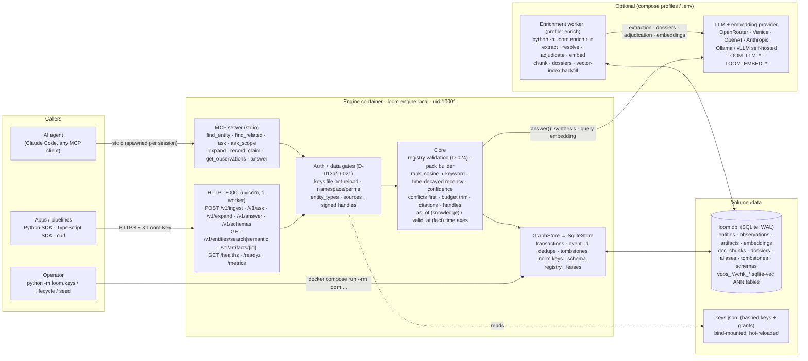
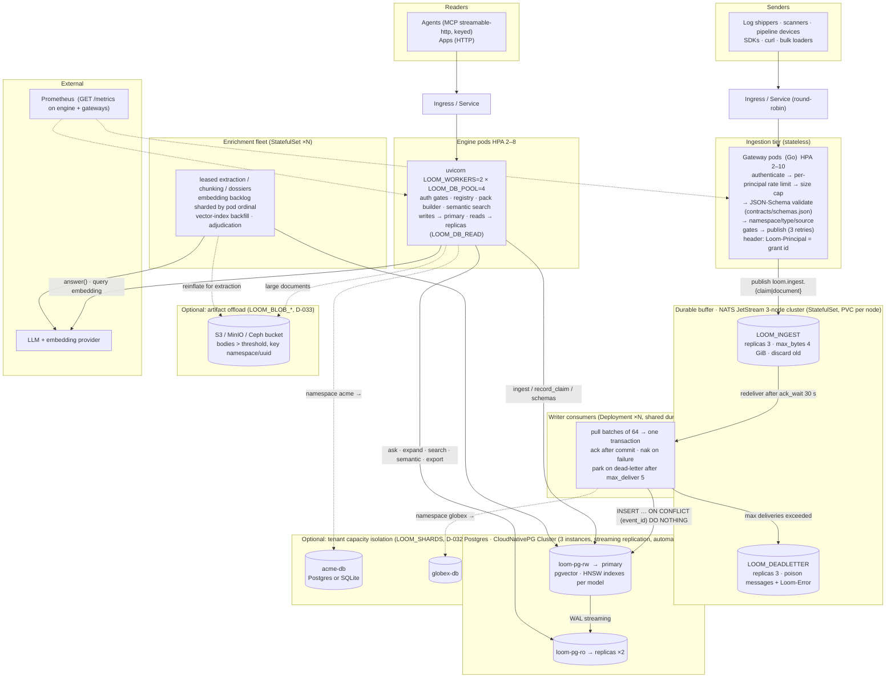
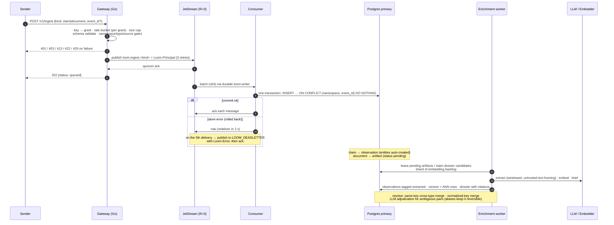

# Infrastructure views

Two deployment shapes of the same contract, plus the two request flows that
matter. Everything a small team runs is in the first diagram; everything a
platform team can turn on is in the second. Nothing in the second changes
the API, the SDKs, or the MCP tools. Dials referenced here are documented in
`../deploy/README.md`; decisions in `decisions.md` (D-008…D-033).

## 1. Simple shape — one container on a laptop or a small VPS

`docker compose up loom`. One engine process, one SQLite file on a volume,
no queue, no operator. The enrichment worker and the answering LLM are
optional; without them Loom still ingests, ranks by keyword, and serves
cited packs.



What each box guarantees: every pack item is cited (D-023); writes are
append-only and idempotent on `event_id` (D-014/D-022); redaction is a
tombstone (D-016); a scoped key sees a scoped world, never a wall of errors
(D-013a/D-021); the vector index is derived from the portable JSON vectors
and falls back to an exact scan (D-025).

## 2. Scaled shape — `deploy/k8s/scale-pg-ha` (every dial on)

Same image, same contract. Stateless tiers scale on CPU; the two stateful
tiers (queue, database) are replicated clusters run by boring, shipped
components. Dials are env vars or overlays; a team turns on only what a
measurement asks for.



Failure modes this shape was tested against on a k3s cluster (D-029/D-030):
a JetStream leader deleted mid-burst (3000/3000 acknowledged, nothing lost
or duplicated); the Postgres primary deleted under synchronous writes and
replica reads (319/319 and 319/319, failover completed). Engine and worker
pods wait up to 180 s for a booting database instead of crash-looping.

## 3. Read flow — `POST /v1/ask` (same code path in both shapes)

```mermaid
sequenceDiagram
    autonumber
    participant A as Agent / App
    participant H as HTTP route
    participant G as Auth + gates
    participant P as Pack builder
    participant S as GraphStore
    participant E as Embedder (optional)

    A->>H: POST /v1/ask {subject|scope, question, budget, as_of?, valid_at?}
    H->>G: X-Loom-Key → grant (namespace, perms, entity_types)
    G-->>H: 401 / 403, or grant
    H->>P: build_pack(req, allowed_types)
    P->>S: resolve_scope (BFS over containment predicates; registry default)
    P->>S: observations_for each subject (≤1000, tombstones excluded)
    Note over P: drop subjects / edges outside allowed_types (scoped world)
    opt embedder configured
        P->>E: embed(question)  (memoized per model+text)
        P->>S: embeddings_for(ids) → cosines (numpy)
        P->>S: nearest_chunks(cited artifacts)  (sqlite-vec / pgvector / exact)
    end
    P->>S: get_dossier per subject (skipped when as_of set)
    Note over P: as_of → hide later-recorded facts<br/>valid_at → keep facts whose window covers T
    Note over P: rank = cosine∘keyword + time-decayed recency + confidence<br/>extracted (doc:) claims discounted
    Note over P: conflicts first (cross-source scalar disagreement)<br/>→ brief → excerpts (≤ half remaining) → facts, until budget
    Note over P: every item cited; what didn't fit → handles<br/>(more | conflict | excerpt), HMAC-signed if LOOM_HANDLE_SECRET
    P-->>H: ContextPack
    H-->>A: 200 {items[], handles[], budget, subjects[]}
    A->>H: POST /v1/expand {handle}  (same gates re-applied)
```

## 4. Write flow — ingest through the scaled tier



## Reading the two shapes together

| Concern | Simple | Scaled |
| --- | --- | --- |
| Ingest path | direct write to SQLite | gateways → replicated JetStream → N consumers → Postgres primary |
| Read path | same process, same file | engine replicas, reads on Postgres replicas |
| Vector search | sqlite-vec tables beside the JSON vectors | pgvector HNSW; exact scan if the extension is absent |
| Enrichment | one optional worker | leased, sharded StatefulSet |
| Tenant isolation | namespaces (data) | namespaces + `LOOM_SHARDS` (capacity) |
| Documents | in the database | offloaded to object storage above a threshold |
| Auth | keys file, hot-reloaded | same file as a Secret, mounted on engines and gateways |
| What changes for callers | nothing | nothing |
